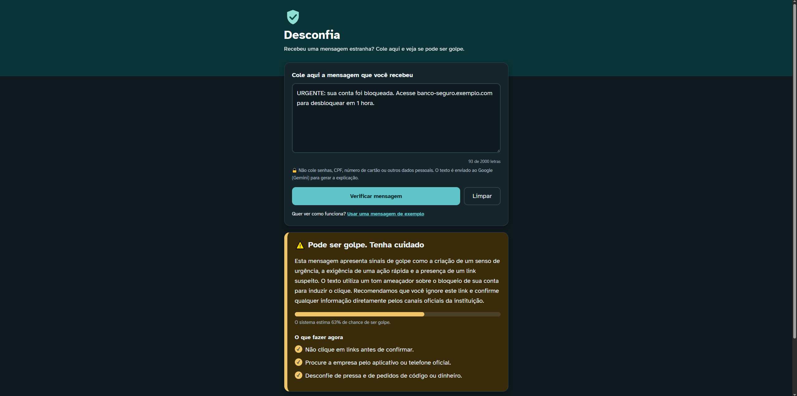

# Desconfia

Detector de mensagens suspeitas em português. Você cola o texto que recebeu e o Desconfia mostra a chance de ser golpe, explica o motivo em linguagem simples e diz o que fazer agora.

**Teste online:** https://desconfia-three.vercel.app



> Esta análise é uma ajuda e pode errar. Na dúvida, não clique em links e confirme pelo telefone ou aplicativo oficial da empresa.

## O problema

Golpes por mensagem (falsos bloqueios de conta, cobranças, prêmios, "parentes" pedindo dinheiro) atingem principalmente quem não tem familiaridade com tecnologia. O Desconfia dá uma segunda opinião rápida e explica o resultado sem jargão.

## Como funciona

1. **Classificador:** um pipeline do scikit-learn (TF-IDF com unigramas e bigramas + Regressão Logística com classes balanceadas) estima o risco de a mensagem ser golpe.
2. **Explicação:** a API do Google Gemini escreve uma explicação curta e coerente com o nível de risco calculado. O prompt manda ignorar instruções que estejam dentro da mensagem (defesa contra prompt injection).
3. **API:** FastAPI valida a entrada, aplica limite de uso e entrega o resultado ao front-end estático (HTML, CSS e JavaScript puro).

## Resultados do modelo

| Métrica | Valor |
|---|---|
| Base de dados | 64 mensagens fictícias, escritas à mão |
| Validação | 5 folds (StratifiedKFold) |
| Acurácia em validação cruzada | cerca de 83% |

Os números completos (precisão, revocação, matriz de confusão) aparecem ao rodar `python -m app.treinar`.

## Limitações

- **Base pequena e fictícia.** Com 64 mensagens, o modelo é uma prova de conceito. Em mensagens reais e variadas, a confiança é baixa e o resultado pode errar para os dois lados.
- **Limite de uso fraco em ambiente serverless.** O limitador fica em memória de cada instância, então não é uma barreira rígida no Vercel. Para uso real, seria preciso um armazenamento compartilhado (por exemplo, Redis).
- **Dependência externa.** A explicação depende do Gemini. Se ele falhar ou demorar mais de 10 segundos, o resultado do classificador continua sendo exibido, com um aviso.
- **Não substitui verificação oficial.** A ferramenta ajuda a desconfiar, não garante que uma mensagem é segura.

## Privacidade

- O texto colado é enviado ao Google (Gemini) para gerar a explicação. Por isso, a página pede para não colar senhas, CPF, número de cartão ou outros dados pessoais.
- O Desconfia não guarda as mensagens.
- A chave da API fica em variável de ambiente, nunca no código nem no repositório.

## Como rodar localmente

Requisitos: Python 3.12.

```bash
git clone https://github.com/hyanndossantosespindas/desconfia.git
cd desconfia

python -m venv .venv
source .venv/Scripts/activate     # Windows (Git Bash)
# source .venv/bin/activate       # Linux e macOS

pip install -r requirements-dev.txt

cp .env.example .env              # depois edite o .env com a sua chave do Gemini

python -m app.treinar             # treina e salva o modelo em models/modelo.joblib
uvicorn app.main:app --reload
```

Abra http://127.0.0.1:8000.

### Variáveis de ambiente

| Variável | Descrição | Padrão |
|---|---|---|
| `GEMINI_API_KEY` | Chave da API do Gemini (obrigatória para a explicação) | – |
| `GEMINI_MODEL` | Modelo usado na explicação | `gemini-3.1-flash-lite` |
| `LIMITE_POR_MINUTO` | Verificações por visitante a cada 60 s | `5` |
| `LIMITE_GERAL_POR_HORA` | Verificações totais por hora | `100` |

## Endpoints

| Método | Rota | Descrição |
|---|---|---|
| `GET` | `/` | Página do Desconfia |
| `GET` | `/saude` | Verificação de funcionamento (`{"status": "ok"}`) |
| `POST` | `/analisar` | Recebe `{"texto": "..."}` e devolve risco, classificação e explicação |

Exemplo:

```bash
curl -X POST http://127.0.0.1:8000/analisar \
  -H "Content-Type: application/json" \
  -d '{"texto": "URGENTE: sua conta foi bloqueada. Acesse banco-seguro.exemplo.com para desbloquear em 1 hora."}'
```

Resposta:

```json
{
  "risco": 0.63,
  "classificacao": "golpe",
  "explicacao": "..."
}
```

Erros tratados: `422` (texto vazio, só espaços ou fora de 5 a 2000 caracteres), `429` (limite de uso, com `Retry-After`) e `503` (modelo não treinado).

## Testes

```bash
python -m pytest
```

São 8 testes (API e limitador de uso). O modelo e a chamada ao Gemini são isolados com `monkeypatch`, então os testes não usam a internet nem a chave.

## Estrutura

```
app/
  treinar.py      # treina e avalia o classificador
  analisador.py   # carrega o modelo e calcula o risco
  explicador.py   # explicação via Gemini (com tratamento de falhas)
  limitador.py    # limite de uso por janela deslizante
  main.py         # API FastAPI
  static/         # front-end (HTML, CSS, JS)
data/mensagens.csv  # base fictícia usada no treino
tests/              # testes com pytest
vercel.json         # treina o modelo no build do deploy
```

## Tecnologias

Python 3.12, FastAPI, scikit-learn, pandas, joblib, Google Gemini API, pytest, Vercel.

## Próximos passos

- Ampliar e diversificar a base de dados (com mensagens reais anonimizadas, com autorização).
- Trocar o limitador em memória por um armazenamento compartilhado.
- Rodar os testes automaticamente com GitHub Actions.

## Autor

Desenvolvido por Hyann dos Santos Espindas — [hyann.dev](https://hyann.dev)
